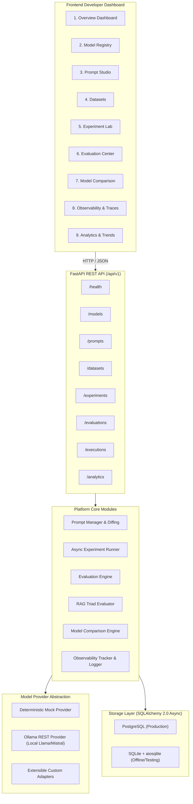
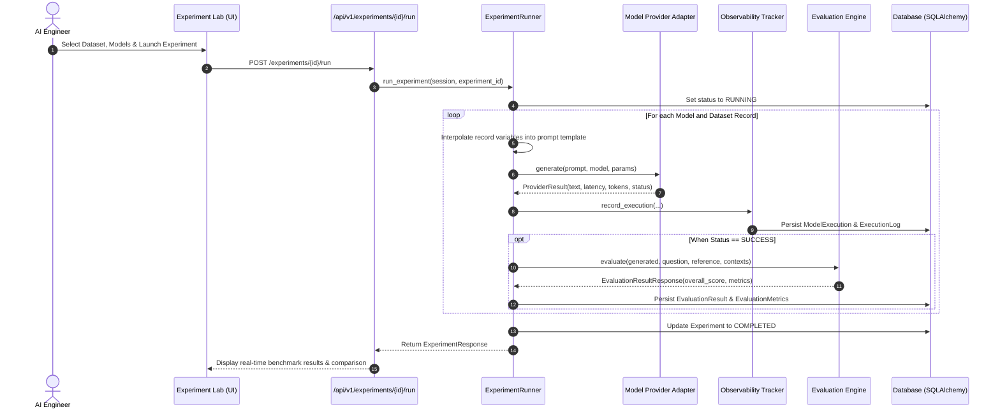

# LLMOps Studio
### LLM Evaluation, Experimentation & Observability Platform

[](https://www.python.org/downloads/)
[](https://fastapi.tiangolo.com)
[](https://www.sqlalchemy.org/)
[](LICENSE)
[]()

LLMOps Studio is an enterprise-grade evaluation, experimentation, and observability platform for Large Language Model (LLM) applications and Retrieval-Augmented Generation (RAG) pipelines.

It empowers AI engineers, backend developers, and ML infrastructure teams to benchmark diverse LLM models, test prompt variations, measure execution latency, trace token consumption, evaluate response quality with mathematically grounded metrics, detect potential hallucinations, and debug failed generations.

---

## 1. Core Capabilities

- **Model Provider Abstraction**: Provider-independent architecture with native support for local Ollama models (Llama 3, Mistral 7B) and a high-speed deterministic mock provider for zero-cost offline benchmarking.
- **Prompt Engineering & Versioning**: Immutable prompt versioning, dynamic `{variable}` template parsing, version diffing, and interactive live execution with telemetry capture.
- **Multi-Model Experiment Lab**: Asynchronous batch execution of prompts across multiple models on structured evaluation datasets with automated quality scoring.
- **Modular Evaluation Engine**: 7 comprehensive evaluation metrics returning standardized scores ($0.0 \to 1.0$), explanation rationales, and verdict statuses (`PASS`, `WARNING`, `FAIL`).
- **The RAG Triad Evaluator**: Dedicated assessment of Context Relevance, Faithfulness (Groundedness), Answer Relevance, and Context Coverage.
- **Observability & Trace Telemetry**: Full lifecycle request tracing, capturing UUID request IDs, execution duration, input/output tokens, cost calculations, and structured audit logs.
- **Comparative Benchmarking**: Multi-model comparison matrix detailing evaluation scores, mean/p95 latency, token usage, and side-by-side response outputs.
- **Failure Analysis & Diagnostics**: Root-cause categorization for timeouts, empty completions, provider unreachability, and malformed outputs.
- **Interactive Web Dashboard**: Single-page dark-mode developer console built with vanilla JavaScript, modern CSS, and Chart.js analytics.

---

## 2. System Architecture



---

## 3. Experiment Execution Lifecycle



---

## 4. Evaluation Methodology

| Metric | Formulation & Strategy | Score Range | Primary Focus |
| :--- | :--- | :---: | :--- |
| **Exact Match** | Character identity & normalized token matching | $0.0 \text{ or } 1.0$ | Strict classification / deterministic outputs |
| **Semantic Similarity** | N-gram TF-IDF composite cosine distance ($0.4 \text{ unigram} + 0.3 \text{ bigram} + 0.3 \text{ char trigram}$) | $0.0 \to 1.0$ | Semantic intent alignment |
| **Answer Relevance** | Query keyword recall & semantic alignment with brevity penalty | $0.0 \to 1.0$ | Query satisfaction |
| **Context Relevance** | Signal-to-noise ratio in retrieved context passages | $0.0 \to 1.0$ | Retrieval pipeline quality |
| **Faithfulness** | Ratio of generated atomic statements grounded in context | $0.0 \to 1.0$ | Factual grounding in RAG |
| **Response Completeness**| Information unit and entity recall against reference answer | $0.0 \to 1.0$ | Factual coverage |
| **Hallucination Risk** | Heuristic detection of ungrounded numbers, dates, and named entities | $0.0 \to 1.0$ (Risk) | Anomaly detection |

### RAGAS Architectural Compatibility
LLMOps Studio implements data contracts compatible with the RAGAS framework (`question`, `retrieved_contexts`, `generated_answer`, `reference_answer`). Metrics operate deterministically and offline without requiring paid API tokens.

---

## 5. Technology Stack

- **Backend**: Python 3.11+, FastAPI, Pydantic v2, SQLAlchemy 2.0, AsyncIO, Greenlet
- **Database**: PostgreSQL (Production) / SQLite with `aiosqlite` (Default / Local)
- **Model Providers**: Local Ollama (Llama 3, Mistral 7B) & Deterministic Mock Provider
- **Frontend**: HTML5, Modern CSS3, Vanilla JavaScript, Chart.js
- **Testing**: Pytest, Pytest-AsyncIO, HTTPX
- **Containerization**: Docker, Docker Compose (Multi-stage build)

---

## 6. Installation & Quick Start

### Prerequisites
- Python 3.11+
- Git
- (Optional) Docker & Docker Compose
- (Optional) [Ollama](https://ollama.ai) for local model execution

### Local Setup

1. **Clone the repository**:
   ```bash
   git clone https://github.com/your-username/llmops-studio.git
   cd llmops-studio
   ```

2. **Create and activate a virtual environment**:
   ```bash
   python -m venv .venv
   # Windows PowerShell:
   .venv\Scripts\Activate.ps1
   # Linux/macOS:
   source .venv/bin/activate
   ```

3. **Install dependencies**:
   ```bash
   pip install -r requirements.txt
   ```

4. **Configure environment variables**:
   ```bash
   cp .env.example .env
   ```

5. **Seed sample benchmarks**:
   ```bash
   python scripts/seed_data.py
   ```

6. **Start the application server**:
   ```bash
   uvicorn app.main:app --host 0.0.0.0 --port 8000 --reload
   ```

7. **Access the application**:
   - Web Console: [http://localhost:8000](http://localhost:8000)
   - Interactive Swagger API: [http://localhost:8000/docs](http://localhost:8000/docs)
   - ReDoc Documentation: [http://localhost:8000/redoc](http://localhost:8000/redoc)

---

## 7. Running with Docker Compose

To run the complete production stack (FastAPI backend + PostgreSQL 16):

```bash
docker compose up -d
```

To run with local Ollama service enabled:
```bash
docker compose --profile full up -d
```

---

## 8. Interactive CLI Demonstration

To experience an end-to-end evaluation run directly in the terminal:

```bash
python scripts/run_demo.py
```

---

## 9. Automated Testing

The platform includes a test suite covering providers, prompt versioning, dataset ingestion, all evaluation metrics, the RAG Triad, execution tracking, model comparison, analytics, and REST API endpoints.

To run the test suite:

```bash
pytest -v
```

### Verified Test Results
```text
============================= test session starts =============================
platform win32 -- Python 3.11.17, pytest-9.2.0, pluggy-1.7.0
rootdir: llmops-studio, configfile: pyproject.toml
plugins: anyio-4.16.0, asyncio-1.4.1.post1
collected 41 items

tests/test_analytics.py::test_analytics_overview_and_models PASSED       [  2%]
tests/test_analytics.py::test_failure_analytics_categorization PASSED    [  4%]
tests/test_api.py::test_api_health PASSED                                [  7%]
tests/test_api.py::test_api_models_flow PASSED                           [  9%]
tests/test_api.py::test_api_prompts_flow PASSED                          [ 12%]
tests/test_api.py::test_api_datasets_flow PASSED                         [ 14%]
tests/test_api.py::test_api_evaluations_run PASSED                       [ 17%]
tests/test_api.py::test_api_rag_evaluations_endpoint PASSED              [ 19%]
tests/test_api.py::test_api_analytics_endpoints PASSED                   [ 21%]
tests/test_api.py::test_api_error_validation_cases PASSED                [ 24%]
tests/test_comparison.py::test_model_comparison_engine_output PASSED     [ 26%]
tests/test_datasets.py::test_validate_empty_dataset_raises PASSED        [ 29%]
tests/test_datasets.py::test_validate_missing_question_raises PASSED     [ 31%]
tests/test_datasets.py::test_parse_json_dataset_valid PASSED             [ 34%]
tests/test_datasets.py::test_parse_csv_dataset_valid PASSED              [ 36%]
tests/test_datasets.py::test_dataset_manager_create PASSED               [ 39%]
tests/test_evaluation.py::test_exact_match_metric PASSED                 [ 41%]
tests/test_evaluation.py::test_semantic_similarity_metric PASSED         [ 43%]
tests/test_evaluation.py::test_answer_relevance_metric PASSED            [ 46%]
tests/test_evaluation.py::test_context_relevance_metric PASSED           [ 48%]
tests/test_evaluation.py::test_faithfulness_metric PASSED                [ 51%]
tests/test_evaluation.py::test_response_completeness_metric PASSED       [ 53%]
tests/test_evaluation.py::test_hallucination_risk_indicator PASSED       [ 56%]
tests/test_evaluation.py::test_composite_evaluation_engine PASSED        [ 58%]
tests/test_experiments.py::test_full_experiment_lifecycle PASSED         [ 60%]
tests/test_observability.py::test_percentile_calculations PASSED         [ 63%]
tests/test_observability.py::test_error_categorization PASSED            [ 65%]
tests/test_observability.py::test_execution_tracker_persistence PASSED   [ 68%]
tests/test_prompts.py::test_template_variable_extraction PASSED          [ 70%]
tests/test_prompts.py::test_template_variable_rendering PASSED           [ 73%]
tests/test_prompts.py::test_prompt_creation_and_versioning PASSED        [ 75%]
tests/test_prompts.py::test_prompt_execution_flow PASSED                 [ 78%]
tests/test_providers.py::test_mock_provider_deterministic_generation PASSED [ 80%]
tests/test_providers.py::test_mock_provider_timeout_simulation PASSED    [ 82%]
tests/test_providers.py::test_mock_provider_empty_response_simulation PASSED [ 85%]
tests/test_providers.py::test_mock_provider_malformed_output_simulation PASSED [ 87%]
tests/test_providers.py::test_mock_provider_health_check PASSED          [ 90%]
tests/test_providers.py::test_ollama_provider_unreachable_connection PASSED [ 92%]
tests/test_providers.py::test_provider_registry_lifecycle PASSED         [ 95%]
tests/test_rag_evaluator.py::test_rag_triad_evaluation_high_quality PASSED [ 97%]
tests/test_rag_evaluator.py::test_rag_triad_evaluation_hallucination_detection PASSED [100%]

============================= 41 passed in 3.56s ==============================
```

---

## 10. Known Limitations & Roadmap

### Known Limitations
- **Heuristic Hallucination Indicator**: Evaluates lexical entity overlap and contradiction cues; does not perform formal natural language inference (NLI) or entailment verification.
- **Single-Node Execution**: In the default configuration, experiment test cases run concurrently within a single Python process rather than distributed over a Celery/RabbitMQ cluster.
- **Token Estimation**: When providers do not return exact hardware token counts, token numbers are computed using character-and-word heuristic models (~1.3x words + char length / 25).

### Future Improvements
- [ ] Distributed worker task queues (Celery + Redis) for large-scale (10k+) benchmark runs.
- [ ] Direct integration with HuggingFace datasets hub.
- [ ] Multi-turn conversational conversation trace evaluations.
- [ ] Cross-encoder re-ranker integration for context relevance.
- [ ] Exportable PDF and CSV executive evaluation reports.

---

## 11. License

This project is licensed under the Apache 2.0 License. See [LICENSE](LICENSE) for details.

