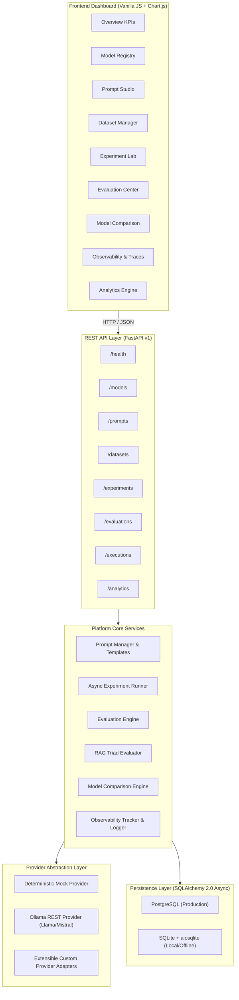
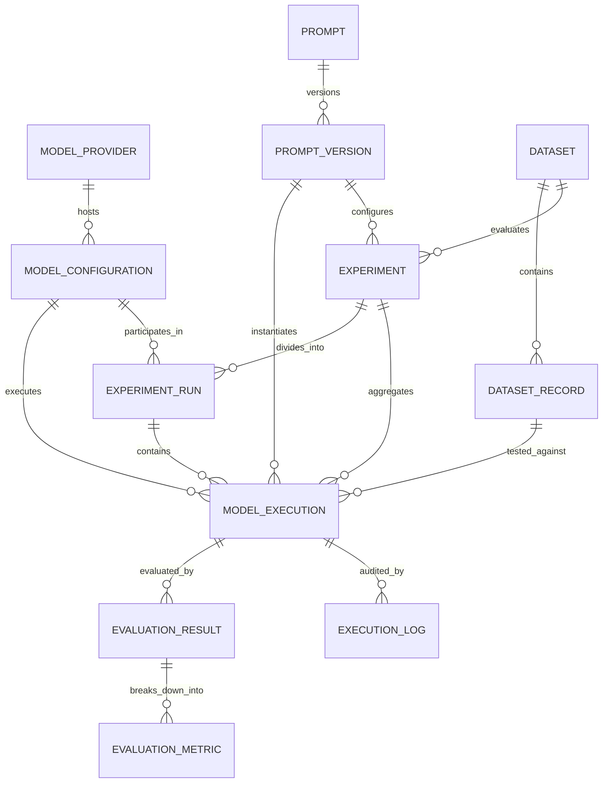

# System Architecture — LLMOps Studio

## 1. High-Level Overview

LLMOps Studio is an enterprise-grade evaluation, experimentation, and observability platform designed for Large Language Model (LLM) systems and Retrieval-Augmented Generation (RAG) pipelines.

The platform provides a modular, provider-agnostic infrastructure to benchmark open-source and proprietary models, measure execution latency, track token usage, evaluate response quality, detect potential hallucinations, and trace system performance over time.

---

## 2. Component Design

### A. Model Provider Abstraction
The model provider abstraction (`app/providers/base.py`) decouples high-level experimentation logic from specific model hosting vendors.
- **`BaseModelProvider`**: Defines standard asynchronous methods (`generate`, `check_health`, `list_models`).
- **`MockProvider`**: Provides deterministic completions, synthetic token calculation, and controllable error simulations (`[SIMULATE_TIMEOUT]`, `[SIMULATE_EMPTY]`, `[SIMULATE_ERROR]`, `[SIMULATE_MALFORMED]`).
- **`OllamaProvider`**: Communicates with the local or remote Ollama daemon REST API (`/api/generate`, `/api/tags`).
- **`ProviderRegistry`**: Dynamic registration and discovery of active providers and model configurations.

### B. Prompt Management & Versioning
- **Template Parser**: Employs variable interpolation using `{variable_name}` syntax.
- **Persistent Versioning**: Every prompt modification creates an incremented immutable `PromptVersion` record linked to its parent `Prompt`.
- **Diffing Engine**: Computes line-by-line diffs and detects variable additions or removals between versions.

### C. Evaluation Engine & The RAG Triad
- **Modular Metrics**:
  - `ExactMatchMetric`: Strict and normalized exact text matching.
  - `SemanticSimilarityMetric`: Deterministic N-gram TF-IDF composite cosine distance.
  - `AnswerRelevanceMetric`: Query keyword recall and semantic alignment.
  - `ContextRelevanceMetric`: Signal-to-noise ratio in retrieved context passages.
  - `FaithfulnessMetric`: Sentence-level claim decomposition and context grounding verification.
  - `ResponseCompletenessMetric`: Expected fact and entity recall against reference answers.
  - `HallucinationRiskMetric`: Heuristic ungrounded entity and contradiction detection.
- **RAG Evaluator**: Computes the composite RAG Triad score (Context Relevance, Groundedness, Answer Relevance, Context Coverage).

### D. Observability & Telemetry Tracking
Every invocation passes through `ExecutionTracker`, creating a `ModelExecution` record capturing:
- Globally unique `request_id` (UUIDv4)
- Model identifier and provider
- Precise latency measurement via high-resolution monotonic clocks (`time.perf_counter()`)
- Input, output, and total token usage
- Structured execution audit trail logs (`ExecutionLog`)
- Transparent cost calculation (strictly populated only when pricing is explicitly configured)

---

## 3. Database Entity-Relationship Diagram

