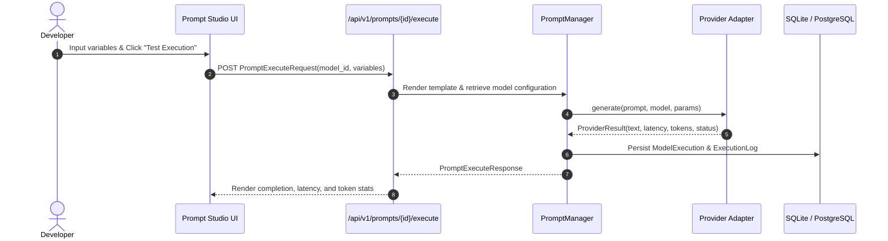

# Prompt Management & Versioning — LLMOps Studio

## 1. Overview

Effective LLMOps requires treating prompt engineering as software source code: with strict versioning, diff comparisons, variable validations, and persistent audit trails.

The Prompt Studio in LLMOps Studio facilitates prompt design, version history tracking, live variable interpolation, and direct model execution.

---

## 2. Template Syntax & Variable Extraction

Templates use Python `{variable_name}` syntax:

```text
Context:
{context}

Question:
{question}

Provide a factual response strictly grounded in the context above:
```

### Safety & Parsing
- The regex parser (`re.compile(r"\{([a-zA-Z_][a-zA-Z0-9_]*)\}")`) safely extracts variable identifiers without invoking unsafe runtime code execution (`eval` or `exec`).
- If an input variable is omitted during execution, the engine flags it in the missing variables array and substitutes a clear placeholder `[var_name: missing]` to avoid template crash.

---

## 3. Immutable Versioning & Diff Engine

- Every edit creates an incremented immutable `PromptVersion` record (`v1`, `v2`, `v3`).
- Older versions cannot be silently mutated, ensuring reproducible historical experiment results.
- The version comparison engine (`app/prompts/versioning.py`) provides unified diff summaries and detects variable additions or removals.

---

## 4. Interactive Execution Flow



