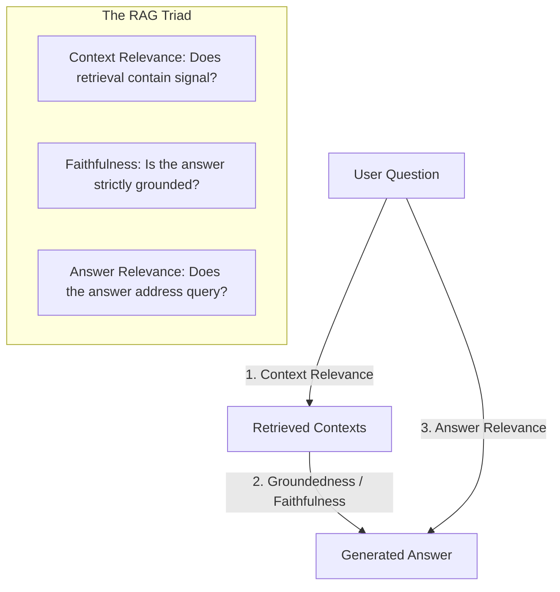

# RAG Evaluation & The RAG Triad — LLMOps Studio

## 1. The RAG Triad Concept

Retrieval-Augmented Generation (RAG) bridges external knowledge with generative language models. However, failures can occur at the retrieval stage, generation stage, or both.

LLMOps Studio implements the canonical **RAG Triad** framework to isolate where quality degradation occurs:



---

## 2. Metric Formulations

### A. Context Relevance
- **Question**: Did the retriever pull relevant passages or distracting noise?
- **Computation**: Measures query keyword coverage and sentence-level pertinent chunk ratios across retrieved context fragments.
- **Score Range**: $0.0 \to 1.0$.

### B. Groundedness (Faithfulness)
- **Question**: Did the generator hallucinate facts not present in the context?
- **Computation**: Splits generated output into individual declarative statements. Verifies that every assertion has supporting evidence in the context chunks.
- **Score Range**: $0.0 \to 1.0$.

### C. Answer Relevance
- **Question**: Does the generated text actually respond to what the user asked?
- **Computation**: Combines keyword recall from the query and cosine semantic alignment, penalizing irrelevant digressions.
- **Score Range**: $0.0 \to 1.0$.

### D. Context Coverage
- **Question**: How much of the necessary information contained in the context was synthesized?
- **Computation**: Evaluates relative information density and length ratio between context content and answer units.

### Composite RAG Quality Score
$$\text{RAG Triad Score} = 0.35 \cdot \text{Faithfulness} + 0.35 \cdot \text{AnswerRelevance} + 0.30 \cdot \text{ContextRelevance}$$

---

## 3. Dedicated API & UI Evaluation

- **REST Endpoint**: `POST /api/v1/evaluations/rag`
- **Payload**:
  ```json
  {
    "question": "What is the time complexity of Scaled Dot-Product Attention?",
    "retrieved_contexts": [
      "Scaled Dot-Product Attention computes softmax(QK^T / sqrt(d)) V.",
      "Matrix multiplication of Q (NxD) and K (NxD) scales quadratically as O(N^2)."
    ],
    "generated_answer": "Standard Scaled Dot-Product Attention scales with O(N^2) quadratic complexity in sequence length N.",
    "reference_answer": "Scaled Dot-Product Attention has an O(N^2) quadratic time complexity."
  }
  ```
- **Response**: Returns individual component scores, composite RAG score, hallucination risk flag, and detailed metric breakdown cards.

